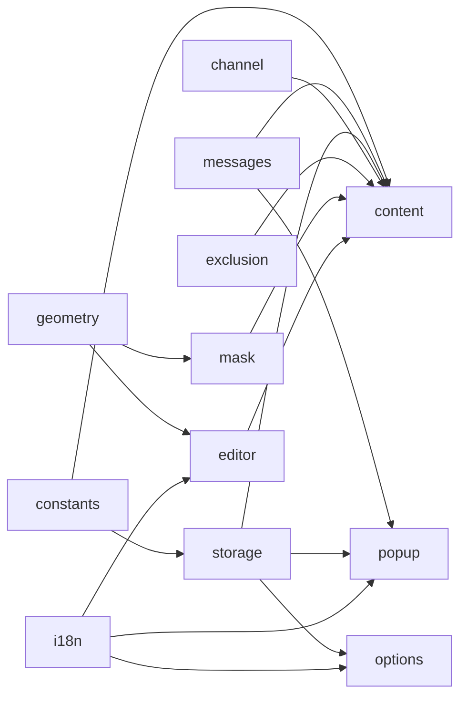

# A.T.Field — TypeScript 마이그레이션 구현 계획서

> 대상: `at-field` v0.1.1 (Vanilla JS, Firefox MV3, `strict_min_version: 142.0`)
> 목표: **동작 변경 없이(Zero-Regression)** TypeScript Strict + ESM 모듈 구조로 옮기기
> 상태: **리뷰 반영 완료 (rev.2)** — 결정 사항은 §7 참고. 실제 작업은 CLI에서 이 문서를 기준으로 진행

---

## 0. 현재 코드 분석 요약 (Inspection)

### 0.1 파일 구성과 로딩 방식

| 영역 | 파일 | 로딩 방식 |
|---|---|---|
| Shared | [constants.js](file:///Users/hanayor/personal-project/at-field/shared/constants.js), [messages.js](file:///Users/hanayor/personal-project/at-field/shared/messages.js), [storage.js](file:///Users/hanayor/personal-project/at-field/shared/storage.js), [i18n.js](file:///Users/hanayor/personal-project/at-field/shared/i18n.js) | IIFE → `globalThis.ATF.*` 에 붙이고, 동시에 `module.exports`도 설정 (테스트용) |
| Content | [geometry.js](file:///Users/hanayor/personal-project/at-field/content/geometry.js), [channel.js](file:///Users/hanayor/personal-project/at-field/content/channel.js), [exclusion.js](file:///Users/hanayor/personal-project/at-field/content/exclusion.js), [mask.js](file:///Users/hanayor/personal-project/at-field/content/mask.js), [editor.js](file:///Users/hanayor/personal-project/at-field/content/editor.js), [content.js](file:///Users/hanayor/personal-project/at-field/content/content.js) | manifest `content_scripts.js` 배열에 10개 파일을 **순서대로 나열**. 순서가 곧 의존성 |
| Popup | [popup.html](file:///Users/hanayor/personal-project/at-field/popup/popup.html) + [popup.js](file:///Users/hanayor/personal-project/at-field/popup/popup.js) | `<script>` 5개를 순서대로 로드 |
| Options | [options.html](file:///Users/hanayor/personal-project/at-field/options/options.html) + [options.js](file:///Users/hanayor/personal-project/at-field/options/options.js) | `<script>` 5개를 순서대로 로드 |
| Static | `_locales/{en,ko}` (키 33개씩), `icons/icon.svg`, `content/content.css` | 그대로 복사 |
| Tests | `test/*.test.js` (5개, `node:test` + `require`) | `globalThis.window` / `document`를 직접 목(mock) |

### 0.2 모듈 의존 그래프



### 0.3 핵심 런타임 흐름

1. **초기화** (`content.init`): `migrate()` → `getSettings()` → `storage.onChanged` / `runtime.onMessage` 리스너 등록 → `yt-navigate-start/finish` 리스너 → `observeExclusions()` → `findPlayerElements()` → `/watch`이면 `handleNavigation()` 실행.
2. **채널 판별** (`channel.resolveChannel`): 소스를 3단계로 시도(① `yt-navigate-finish` 이벤트 캐시 → ② `#movie_player.wrappedJSObject.getPlayerResponse()` → ③ DOM/meta 파싱). 최대 10회, 150ms에서 시작해 ×1.4씩, 최대 1000ms까지 늘리며 재시도. 시도 중 videoId가 바뀌면 중단.
   - ⚠️ `channel.js`는 **파일이 로드될 때 바로** `yt-navigate-finish` 리스너를 등록함. 이 리스너가 `content.js`의 리스너보다 **먼저** 등록되어야 캐시가 채워진 뒤에 `handleNavigation`이 돈다.
   - ⚠️ Firefox X-ray 언랩(`event.wrappedJSObject`, `playerEl.wrappedJSObject`)에 의존하고 있으며, 이 속성들은 TS 타입에 없음.
3. **렌더링** (`sync`): 비활성/제외 조건/프리셋 없음이면 `removeAllMasks`. 아니면 `createMaskElement` → `.atf-mask-filter`에 `applyMaskStyle` 적용 → `updateMaskPosition`.
4. **좌표계**: 저장값은 **비디오 렌더 박스 기준 비율(0~1)**. `getVideoBox`로 레터박스/필러박스 여백을 빼고, `toPx`/`toRatio`로 변환한 뒤 `clampRect`(최소 크기 0.02)로 범위를 제한.
5. **재배치 트리거**: `window.resize`, `fullscreenchange`, `video.loadedmetadata/resize`, `ResizeObserver(player, video)`. 모두 `requestAnimationFrame` 하나로 묶어(coalesce) 처리.
6. **편집기** (`MaskEditor`): Pointer Capture로 드래그·리사이즈(8방향 핸들), 포인터 이동은 rAF로 스로틀. 저장은 300ms 디바운스. `keydown`은 capture 단계에서 받음(Esc 롤백 / Enter 저장 / 방향키 0.002 단위, Shift 누르면 0.01 / YouTube 단축키 차단).
7. **스토리지 스키마**: `meta`, `settings`, `ch:<UC…>` 키. 프리셋 구조는 `profiles[].masks[]`이고 UI에서는 `masks[0]` 하나만 씀. `normalizePreset`이 레거시 평면 구조(`rect`/`style`/`masks`)도 받아서 업그레이드함.
8. **메시지 프로토콜** (popup → content): `ATF_GET_STATE`, `ATF_SET_EDIT_MODE {on}`, `ATF_CREATE_PRESET`. 응답은 `sendResponse` + `return true` 패턴. 팝업 쪽에 2.5초 타임아웃 래퍼가 있음.

### 0.4 의존성 현황

- `devDependencies`는 `web-ext@^10.7.0` 하나뿐. `npm audit` 결과 **5건(High 2, Critical 3)** 이며 출처는 전부 `web-ext → fx-runner(shell-quote)`, `@devicefarmer/adbkit(node-forge)` 체인.
- 이 패키지들은 **브라우저 실행/ADB 연결용 개발 도구**라서 배포 번들에는 포함되지 않음. 하지만 lockfile에 들어 있는 한 경고는 계속 뜸.

---

## 1. 도구 체계 비교 및 최종 선정 (Toolchain Decision)

### 1.1 비교

| 기준 | **A. WXT 0.21.x** | B. Vite 수동 멀티 엔트리 | C. esbuild 스크립트 (참고용) |
|---|---|---|---|
| Content Script IIFE 번들 | ✅ 자동으로 처리 | ⚠️ ESM 멀티 엔트리는 공유 청크를 만들어서 content script가 깨짐. lib 모드로 **별도 빌드** 필요 | ✅ `format: 'iife'` |
| manifest 생성/검증 | ✅ `wxt.config.ts`에서 타입 지원 | ❌ 직접 복사·치환 | ❌ 직접 작성 |
| `_locales`/아이콘 복사 | ✅ `public/` | ⚠️ `vite-plugin-static-copy` 등 추가 필요 | ⚠️ 스크립트 작성 |
| Firefox MV3 | ✅ 지원함. 단 **기본값이 MV2라서 `--mv3` 명시 필수** | ✅ (manifest 직접 작성) | ✅ |
| Chrome 확장성 | ✅ `-b chrome` 한 줄로 타겟 추가 가능 (manifest 함수형 설정) | ⚠️ manifest 2벌 직접 관리 | ⚠️ 스크립트 분기 |
| AMO 소스 제출 zip | ✅ `wxt zip -b firefox`가 `*-sources.zip`을 자동으로 만듦 | ❌ | ❌ |
| web-ext 의존 | **optional peer**. 설치하지 않아도 됨 | 없음 | 없음 |
| 의존성 규모 | 큼 (개발 전용) | 중간 | 최소 |
| 단점 | 0.x 버전이라 Breaking Change가 생길 수 있음. auto-import 같은 암묵적 동작 | 빌드 2개 + 커스텀 플러그인을 직접 유지보수해야 함 | 개발 경험(DX)이 낮음 |

> [!NOTE]
> **HMR / dev 서버는 이번 범위에서 제외합니다.** `wxt` dev 모드는 쓰지 않고, 매번 `npm run build`로 빌드한 뒤 `about:debugging`에서 임시 확장으로 직접 로드해 수동으로 확인합니다(§4.6 개발 루프).

### 1.2 최종 선정: **WXT (버전 고정) + 보수적 설정**

**선정 근거**
1. 이 프로젝트에서 가장 까다로운 **IIFE content script와 ESM extension page 빌드를 동시에 처리하는 일**을 설정 없이 해결합니다. Vite로 직접 구성하면 결국 WXT가 하는 일을 손으로 다시 만들게 됩니다.
2. 번들링하면 **AMO 심사 때 소스 제출이 필수**인데, WXT가 소스 zip을 자동으로 만들어 줍니다.
3. `web-ext`가 optional peer라서 **취약점 체인을 lockfile에서 완전히 뺄 수 있습니다.**
4. Firefox 전용 manifest 필드(`browser_specific_settings.gecko`)를 config에서 그대로 쓸 수 있습니다.
5. 향후 **Google Chrome 포팅** 시 같은 소스에서 `wxt build -b chrome`으로 타겟만 추가하면 되고, 브라우저별 manifest 차이는 config 함수에서 분기할 수 있습니다(§4.7).

**오버헤드와 암묵적 동작을 줄이기 위한 설정**

| 설정 | 값 | 이유 |
|---|---|---|
| `wxt` 버전 | `0.21.4` **exact pin** | 0.x 버전의 Breaking Change 차단 |
| `manifestVersion` | `3` (+ CLI `--mv3`) | Firefox 기본값인 MV2를 피함 |
| `imports` | `false` | auto-import를 끄고 모든 의존성을 명시적으로 import. 전역 `browser`는 `@types/firefox-webext-browser` 하나만 쓰게 해서 타입 충돌 방지 |
| `webExt.disabled` (runner) | `true` | web-ext 미설치. `about:debugging`에서 직접 로드 |
| dev 모드 (`wxt` / HMR) | **사용 안 함** | 수동 빌드 + 임시 확장 로드로 확인 (§4.6) |
| `outDir` | `dist` | 요구사항 반영 (`.gitignore`에 이미 포함됨) |
| `vite.build.minify` | `false` (**확정**) | AMO 심사관이 읽을 수 있는 번들 유지 |
| `manifest` | **함수형** `({ browser }) => ({...})` | Firefox 전용 필드를 조건부로 넣어 Chrome 타겟 추가 여지 확보 |
| i18n/storage 헬퍼 | **사용 안 함** (`@wxt-dev/i18n`, `@wxt-dev/storage`) | 기존 로직 보존, 서드파티 추가 지양 |

### 1.3 의존성 구성 (최종)

```jsonc
"devDependencies": {
  "wxt": "0.21.4",                        // 번들러/manifest/zip (vite 포함)
  "typescript": "~5.x",                   // tsc --noEmit 타입 검사
  "@types/firefox-webext-browser": "^143",// 전역 browser.* 타입 (Firefox 전용 API 포함)
  "vitest": "^3.x"                        // 테스트 러너 (확정, Vite 생태계와 통일)
}
// 제거: "web-ext"
// 추가하지 않음: "@types/chrome" (Chrome 폴백은 최소 ambient 선언으로 처리, §3.8)
```

- (**확정**) `web-ext lint` / `sign`은 lockfile에 넣지 않고 **`npx -y web-ext@latest …`로 필요할 때만 실행**합니다. 취약 체인은 개발자 로컬 CLI에만 잠깐 존재하고 프로젝트 의존 트리에는 남지 않습니다.
- 목표: 마이그레이션 완료 시점에 `npm audit` **0건**.

---

## 2. 신규 디렉토리 구조 (Project Structure)

```text
at-field/
├── wxt.config.ts                  # manifest 정의 + 빌드 설정 (manifest.json 대체)
├── tsconfig.json                  # .wxt/tsconfig.json 상속 + strict 옵션 추가
├── vitest.config.ts
├── package.json                   # version 값이 manifest.version으로 사용됨
├── src/
│   ├── entrypoints/               # ← WXT 엔트리 (여기 있는 파일만 엔트리로 인식)
│   │   ├── content/
│   │   │   ├── index.ts           # ← content/content.js  (defineContentScript)
│   │   │   └── style.css          # ← content/content.css (manifest css로 주입)
│   │   ├── popup/
│   │   │   ├── index.html         # ← popup/popup.html (<script type="module" src="./main.ts">)
│   │   │   ├── main.ts            # ← popup/popup.js
│   │   │   └── style.css          # ← popup/popup.css
│   │   └── options/
│   │       ├── index.html         # ← options/options.html (+ manifest.open_in_tab meta)
│   │       ├── main.ts            # ← options/options.js
│   │       └── style.css          # ← options/options.css
│   ├── content/                   # content script 전용 모듈 (엔트리 아님)
│   │   ├── geometry.ts
│   │   ├── channel.ts
│   │   ├── exclusion.ts
│   │   ├── mask.ts
│   │   └── editor.ts
│   ├── shared/                    # 모든 컨텍스트 공용
│   │   ├── constants.ts
│   │   ├── messages.ts
│   │   ├── storage.ts
│   │   ├── i18n.ts
│   │   ├── browser-api.ts         # 신규: browser 우선 → chrome 폴백 어댑터 (Chrome 포팅 대비)
│   │   └── dom.ts                 # 신규: getRequiredElement<T>() 헬퍼 (null 안전)
│   ├── types/
│   │   ├── schema.ts              # Rect, MaskStyle, Preset, Settings, StorageSchema
│   │   ├── geometry.ts            # PxBox, ClientRectLike
│   │   ├── messages.ts            # 메시지 Request/Response 판별 유니온
│   │   ├── channel.ts             # ChannelInfo, ExclusionReason
│   │   ├── youtube.d.ts           # yt-navigate-* 이벤트, PlayerResponse, movie_player
│   │   ├── firefox-xray.d.ts      # wrappedJSObject 타입
│   │   └── chrome-compat.d.ts     # 폴백에서 쓰는 chrome.* 최소 ambient 선언
│   └── public/                    # 그대로 복사됨 (WXT 기본값: <srcDir>/public)
│       ├── _locales/{en,ko}/messages.json
│       └── icons/icon.svg
├── test/
│   ├── fixtures/storage-v0.1.1.json   # 실제 스토리지 스냅샷 (호환성 회귀 테스트용)
│   └── *.test.ts
├── docs/
└── dist/                          # 빌드 결과 (gitignore)
    ├── firefox-mv3/
    │   ├── manifest.json
    │   ├── content-scripts/content.js / content.css
    │   ├── popup.html · options.html · chunks/*.js · assets/*.css
    │   ├── _locales/ · icons/
    └── at-field-0.2.0-firefox.zip / -sources.zip
```

**경로 변화 매핑 (manifest 기준)**

| 기존 | 신규 산출물 |
|---|---|
| `content_scripts.js` 10개 파일 | `content-scripts/content.js` **1개** (번들) |
| `content/content.css` | `content-scripts/content.css` |
| `popup/popup.html` | `popup.html` |
| `options/options.html` | `options.html` |

`.gitignore`에 `.wxt/`, `.output/`를 추가합니다.

---

## 3. 타입 모델 설계 (Type Definitions)

### 3.1 스토리지 스키마 — `types/schema.ts`

```ts
/** 비디오 렌더 박스 기준 0~1 비율 좌표 */
export interface Rect { x: number; y: number; w: number; h: number }

export type MaskStyleType = 'blur' | 'solid';          // Phase 2: | 'image'

export interface MaskStyle {
  type: MaskStyleType;
  color: string;            // /^#[0-9a-fA-F]{3,8}$/
  opacity: number;          // 0~1
  blur: number;             // 0~100 px
  imageId?: string | null;  // Phase 2 예약. DEFAULT_SETTINGS에는 없어서 optional
}

export interface Mask    { id: string; rect: Rect; style: MaskStyle }
export interface Profile { id: string; name: string; masks: Mask[] }

export interface ChannelPreset {
  channelId: string;
  channelName: string;
  enabled: boolean;
  createdAt: number;
  updatedAt: number;
  activeProfileId: string;
  profiles: Profile[];
}

export interface Settings { enabled: boolean; defaultStyle: MaskStyle }
export interface Meta     { schemaVersion: number; initializedAt: number }

export type ChannelKey = `ch:${string}`;

/** storage.local 전체 형태 */
export interface StorageSchema {
  meta?: Meta;
  settings?: Settings;
  [key: ChannelKey]: ChannelPreset | undefined;
}

/** normalizePreset 입력. 레거시 평면 구조까지 포함 (신뢰 불가 데이터) */
export interface RawPresetInput extends Partial<Omit<ChannelPreset, 'profiles'>> {
  profiles?: Array<Partial<Profile> & { masks?: Array<Partial<Mask>> }>;
  rect?: Partial<Rect>;                                   // legacy v0
  style?: Partial<MaskStyle>;                             // legacy v0
  masks?: Array<{ rect?: Partial<Rect>; style?: Partial<MaskStyle> }>; // legacy
}
```

- `normalizePreset(raw: unknown, fallback?: MaskStyle): ChannelPreset | null` — 입력은 `unknown`으로 받고 내부에서 타입을 좁힘(narrowing). **스토리지 값은 신뢰하지 않는다**는 원칙을 타입 수준에서 드러냅니다.
- `storage.local.get()`의 반환값(`any`)은 `shared/storage.ts` **안에서만** `StorageSchema`로 변환하고 바깥으로 `any`가 새지 않게 합니다.

### 3.2 좌표 — `types/geometry.ts`

```ts
export interface PxBox { left: number; top: number; width: number; height: number }
/** DOMRect 또는 테스트용 plain object */
export type ClientRectLike = Pick<DOMRectReadOnly, 'left' | 'top' | 'width' | 'height'>;
```

### 3.3 메시지 프로토콜 — `types/messages.ts`

```ts
export const MESSAGE_TYPES = {
  GET_STATE: 'ATF_GET_STATE',
  SET_EDIT_MODE: 'ATF_SET_EDIT_MODE',
  CREATE_PRESET: 'ATF_CREATE_PRESET',
} as const;

export type AtfRequest =
  | { type: typeof MESSAGE_TYPES.GET_STATE }
  | { type: typeof MESSAGE_TYPES.SET_EDIT_MODE; on: boolean }
  | { type: typeof MESSAGE_TYPES.CREATE_PRESET };

export interface TabState {
  isWatch: boolean;
  exclusionReason: ExclusionReason;
  channel: ChannelInfo | null;
  hasPreset: boolean;
  preset: ChannelPreset | null;
  editMode: boolean;
  globalEnabled: boolean;
}

export interface AtfResponseMap {
  ATF_GET_STATE: TabState;
  ATF_SET_EDIT_MODE: { editMode: boolean };
  ATF_CREATE_PRESET:
    | { success: true; preset: ChannelPreset | null; editMode: boolean }
    | { success: false; error: string };
}

// popup: 요청 타입에 따라 응답 타입이 자동으로 결정됨
declare function sendMessageToTab<R extends AtfRequest>(
  msg: R, timeoutMs?: number
): Promise<AtfResponseMap[R['type']] | null>;
```

### 3.4 채널 / 제외 판정 — `types/channel.ts`

```ts
export interface ChannelInfo { channelId: string; channelName: string }
export type ChannelSource = 'navigate-event' | 'player-object' | 'dom-link' | 'meta-verified';
export interface ChannelResolution extends ChannelInfo { source: ChannelSource }
export type ExclusionReason = 'shorts' | 'non-watch' | 'ad' | 'miniplayer' | null;
```

### 3.5 YouTube / Firefox 환경 타입 — `*.d.ts`

```ts
// firefox-xray.d.ts — Firefox content script 전용 X-ray 언랩
export type XrayWrapped<T> = T & { wrappedJSObject?: T };

// youtube.d.ts
export interface YtVideoDetails { videoId?: string; channelId?: string; author?: string }
export interface YtPlayerResponse { videoDetails?: YtVideoDetails }
export interface YtNavigateFinishDetail { response?: { playerResponse?: YtPlayerResponse } }
export interface YtPlayerElement extends HTMLElement { getPlayerResponse?: () => YtPlayerResponse }

declare global {
  interface WindowEventMap {
    'yt-navigate-start': Event;
    'yt-navigate-finish': CustomEvent<YtNavigateFinishDetail>;
  }
}
```

### 3.6 편집기 — `content/editor.ts`

```ts
export const HANDLES = ['nw','n','ne','e','se','s','sw','w'] as const;
export type HandleDir = typeof HANDLES[number];
export type DragMode = 'move' | HandleDir;

export interface MaskEditorOptions {
  maskEl: HTMLElement;
  playerEl: HTMLElement;
  videoEl: HTMLVideoElement;
  initialRect: Rect;
  onUpdate?: (rect: Rect) => void;
  onSave?: (rect: Rect) => void | Promise<void>;
  onExit?: () => void;
}
```

`bound*` 핸들러는 클래스 필드 화살표 함수로 바꿔서 `bind` 없이 `this` 타입을 보장합니다. 참조가 고정되는 점은 기존과 같습니다.

### 3.7 i18n 키 타입 (의존성 추가 없음)

```ts
import type en from '../public/_locales/en/messages.json';
export type MessageKey = keyof typeof en;
export function getMessage(key: MessageKey, subs?: string | string[]): string;
```
→ 오타 난 키는 컴파일 단계에서 걸러집니다. `editor.ts`의 `getEditorMessage(key, fallback)`도 이 타입을 씁니다.

### 3.8 확장 API 어댑터 — `shared/browser-api.ts` (Chrome 포팅 대비)

기존 코드 5곳에 흩어져 있는 `typeof browser !== 'undefined' ? browser : chrome` 분기를 **동작을 바꾸지 않고** 한 모듈로 모읍니다. 우선순위(`browser` 먼저, 없으면 `chrome`)도 그대로입니다.

```ts
/** 공통 인터페이스는 firefox-webext-browser의 `typeof browser`를 기준으로 삼는다 */
export type ExtensionApi = typeof browser;

/** browser → chrome 순서로 탐색. 둘 다 없으면 null (테스트/Node 환경) */
export function getExtensionApi(): ExtensionApi | null;

/** 기존 storage.js의 getStorageArea 로직 그대로: chrome 콜백 API는 Promise로 감싸서 반환 */
export interface StorageAreaLike {
  get(keys: string | string[] | null): Promise<Record<string, unknown>>;
  set(items: Record<string, unknown>): Promise<void>;
  remove(keys: string | string[]): Promise<void>;
}
export function getStorageArea(): StorageAreaLike | null;
```

| 기존 분기 위치 | 이관 후 |
|---|---|
| `storage.js` `getStorageArea()` (chrome 콜백 → Promise 래핑 포함) | `browser-api.getStorageArea()` |
| `content.js` `init()`의 `storage.onChanged`, `runtime.onMessage` | `getExtensionApi()?.storage.onChanged` 등 |
| `popup.js` `tabs.query` / `tabs.sendMessage` / `runtime.openOptionsPage` | `getExtensionApi()?.tabs` 등 |
| `options.js` `storage.onChanged` | `getExtensionApi()?.storage.onChanged` |
| `i18n.js` `getMessage()` | **예외적으로 i18n.ts 안에 기존 분기 유지.** `browser.i18n.getMessage`가 빈 문자열을 돌려주면 `chrome.i18n`으로 넘어가는 동작을 보존하기 위함 |

**`chrome` 전역 타입 (`types/chrome-compat.d.ts`)**
- `@types/chrome`을 추가하지 않고, 폴백에서 실제로 쓰는 API(`storage.local.get/set/remove`, `storage.onChanged`, `runtime.onMessage`, `runtime.openOptionsPage`, `tabs.query/sendMessage`, `i18n.getMessage`)만 최소한으로 선언합니다: `declare var chrome: ChromeCompat | undefined;`
- WXT가 만드는 타입(`@wxt-dev/browser`)이 이미 전역 `chrome`을 선언하면 중복 선언 에러가 납니다. 이 경우 ambient 선언을 빼고 기존 타입을 씁니다(Phase 1 카나리아에서 확인).

**Firefox 전용 코드의 위치 규칙**
- Firefox 전용 기능(`wrappedJSObject` X-ray 언랩)은 `channel.ts` 안에만 둡니다. 기존처럼 `obj.wrappedJSObject || obj` 형태로 쓰기 때문에 Chrome에서는 자연스럽게 DOM 소스(③)로 넘어갑니다.
- `browser.runtime.getBrowserInfo()`처럼 Chrome에 없는 API는 새로 쓰지 않습니다(Phase 1 타입 카나리아용 임시 코드는 예외이며 확인 후 삭제).

---

## 4. 마이그레이션 전략 (Migration Strategy)

### 4.1 공통 포팅 규칙 (Zero-Regression 원칙)

> [!IMPORTANT]
> **"타입 때문에 바뀌는 것"과 "로직 개선"을 절대 같은 커밋에 섞지 않는다.** 이번 마이그레이션은 앞의 것만 합니다.

1. **IIFE + `globalThis.ATF` + `module.exports` 3중 패턴 → `export` 문 하나로 정리.** `globalThis.ATF.X` 구조분해는 `import`로 바꿉니다.
2. **`||` → `??` 치환 금지.** `Number(rect.x) || DEFAULT` 같은 코드는 `0`을 falsy로 처리하는 현재 동작(PHASE2 항목 1)에 의존하고 있습니다. `@typescript-eslint/prefer-nullish-coalescing` 계열 자동 수정도 쓰지 않습니다.
3. **타입 때문에 추가해야 하는 가드는 기존 런타임 동작과 같아야 합니다.** 예: `savePreset`에서 `normalizePreset()` 결과가 `null`일 수 있는 경로는 → 기존과 같은 `throw new Error('Invalid preset')`.
4. `storage.js`의 **중복 기본값 구조분해(fallback)** 는 ESM import로 값이 반드시 존재하므로 제거합니다(값이 같은지 테스트로 확인).
5. **`chrome.*` 폴백은 지우지 않습니다**(향후 Chrome 포팅 대비). 흩어져 있는 분기는 `shared/browser-api.ts`로 모으되 탐색 순서와 콜백→Promise 래핑 동작은 그대로 유지합니다(§3.8).
6. `maskEl.style.webkitBackdropFilter`는 `lib.dom`에 없으므로 `style.setProperty('-webkit-backdrop-filter', v)`로 바꿉니다. 의미는 같습니다.
7. DOM 조회 결과(`getElementById`, `querySelector`)는 `shared/dom.ts`의 `getRequiredElement<T>(id)`로 감쌉니다. 기존 코드도 요소가 없으면 `addEventListener`에서 TypeError가 났으므로, 명확한 에러로 바뀔 뿐 동작은 같습니다.
8. `any`는 `storage.local.get` 경계와 X-ray 언랩 지점에서만 허용하고, 바로 `unknown`이나 구체 타입으로 좁힙니다.

### 4.2 모듈별 포팅 포인트

| 모듈 | 주의점 |
|---|---|
| `constants.ts` | `DEFAULT_SETTINGS`/`DEFAULT_MASK_RECT`를 `as const satisfies Settings`로 정의하고, 사용할 때는 스프레드 복사본을 넘김 (기존과 같이 변경 방지) |
| `messages.ts` | `MESSAGE_TYPES` `as const`, §3.3의 유니온 export |
| `i18n.ts` | `applyI18n(root: ParentNode = document)`. 순수 DOM 함수 그대로 |
| `geometry.ts` | 순수 함수. 인자를 `ClientRectLike`/`Rect`/`PxBox`로 지정. `rect.x || 0` 그대로 둠 |
| `storage.ts` | `normalize*` 계열은 입력을 `unknown`으로 받음. `updatePreset(id, mutator: (p) => ChannelPreset \| void \| Promise<…>)`. 스토리지 접근은 `browser-api.getStorageArea()` 사용 |
| `browser-api.ts` | 신규. §3.8. 기존 분기를 옮기는 것뿐 새 로직 없음 |
| `exclusion.ts` | `ExclusionReason` 반환. `observeExclusions(cb: (r: ExclusionReason) => void): () => void` |
| `channel.ts` | **로드 시점 부수효과를 명시적 `initChannelTracking()`으로 분리.** content 엔트리 `main()` 맨 앞에서 호출해 리스너 등록 순서(채널 캐시 → navigation 핸들러)를 그대로 유지. WXT도 엔트리 모듈에 top-level 부수효과를 두지 말라고 권장함 |
| `mask.ts` | `createMaskElement`에서 `querySelector<HTMLElement>` 제네릭 사용 |
| `editor.ts` | 클래스 필드에 타입 지정. `e.target`은 `instanceof Element`로 좁힌 뒤 `getAttribute('data-handle-dir') as HandleDir \| null` |
| `content/index.ts` | `defineContentScript({ matches: ['*://www.youtube.com/*'], runAt: 'document_idle', main() {...} })`. 기존의 모듈 스코프 `let` 상태는 `main` 클로저 또는 모듈 스코프에 유지. `readyState` 분기 그대로 |
| `handleStorageChange` | `changes[key].newValue`를 **정규화 없이 그대로** 대입하는 현재 동작 유지 (`as Settings \| undefined`). 바로 다음 `sync()`에서 `getPreset`으로 다시 읽기 때문 |
| `handleMessage` | `(msg: unknown, sender, sendResponse) => true \| undefined`. `isAtfRequest(msg)` 타입 가드 추가. `return true` + async IIFE 패턴 그대로 |
| `popup/main.ts`, `options/main.ts` | `DOMContentLoaded` 리스너 유지. 모듈 스크립트는 defer로 실행되므로 DOMContentLoaded 전에 실행됨(Phase 4에서 확인). `channelCount` 치환 인자 `[String(n)]` 유지 |

### 4.3 manifest → `wxt.config.ts` 매핑

```ts
export default defineConfig({
  srcDir: 'src',
  outDir: 'dist',
  manifestVersion: 3,
  imports: false,
  webExt: { disabled: true },
  vite: () => ({ build: { minify: false } }),
  // 함수형: 브라우저별 차이를 여기서만 분기 (지금은 firefox만 빌드)
  manifest: ({ browser }) => ({
    name: '__MSG_extName__',
    description: '__MSG_extDescription__',
    default_locale: 'en',
    ...(browser === 'firefox' && {
      browser_specific_settings: {
        gecko: {
          id: 'custom-mask-overlay@hanayor',   // ⚠️ 절대 변경 금지 (storage.local이 ID에 묶여 있음)
          strict_min_version: '142.0',
          data_collection_permissions: { required: ['none'] }, // 타입에 없으면 satisfies/캐스팅
        },
      },
    }),
    icons: { 48: 'icons/icon.svg', 96: 'icons/icon.svg' },
    permissions: ['storage'],
    host_permissions: ['*://www.youtube.com/*'],
    action: { default_title: '__MSG_extName__', default_icon: { 48: 'icons/icon.svg', 96: 'icons/icon.svg' } },
  }),
});
```
- `options_ui.open_in_tab`은 `options/index.html`의 `<meta name="manifest.open_in_tab" content="true">`로 지정합니다.
- `content_scripts`는 엔트리의 `defineContentScript`에서 생성됩니다.
- `version`은 `package.json`에서 가져옵니다.

### 4.4 package.json scripts

```jsonc
{
  "build": "wxt build -b firefox --mv3",
  "zip": "wxt zip -b firefox --mv3",          // + sources.zip (AMO 제출용)
  "typecheck": "tsc --noEmit",
  "test": "vitest run",
  "check": "npm run typecheck && npm run test && npm run build",
  "lint:amo": "npx -y web-ext@latest lint -s dist/firefox-mv3",
  "sign": "npx -y web-ext@latest sign -s dist/firefox-mv3 --channel=unlisted",
  "postinstall": "wxt prepare"
}
```
- `dev` 스크립트는 두지 않습니다(HMR 제외).
- Chrome용 `build:chrome` 스크립트도 이번에는 추가하지 않습니다(§4.7).

### 4.5 tsconfig 핵심

```jsonc
{
  "extends": "./.wxt/tsconfig.json",
  "compilerOptions": {
    "strict": true,
    "noUncheckedIndexedAccess": true,   // profiles[0], masks[0] 접근에서 undefined 처리를 강제
    "noImplicitOverride": true,
    "noFallthroughCasesInSwitch": true,
    "verbatimModuleSyntax": true,
    "resolveJsonModule": true,
    "lib": ["ES2022", "DOM", "DOM.Iterable"],
    "types": ["firefox-webext-browser"]
  },
  "include": ["src", "test", "wxt.config.ts", "vitest.config.ts"]
}
```
`exactOptionalPropertyTypes`는 `imageId?` 등 레거시 데이터와 충돌이 많아서 **이번 범위에서는 제외**합니다.

### 4.6 개발 루프 (HMR 없이 수동 확인)

1. `npm run build` → `dist/firefox-mv3/` 생성
2. Firefox `about:debugging#/runtime/this-firefox` → **임시 부가 기능 로드** → `dist/firefox-mv3/manifest.json` 선택
3. 코드를 고친 뒤 `npm run build` 다시 실행 → about:debugging에서 **새로 고침** → YouTube 탭도 새로 고침(기존 content script는 남아 있지 않음)
4. 임시 확장은 Firefox를 재시작하면 해제됩니다. 데이터가 필요하면 Phase 0 스냅샷(`test/fixtures/storage-v0.1.1.json`)을 Inspect 콘솔에서 `browser.storage.local.set(...)`으로 다시 넣습니다.

### 4.7 Chrome 포팅 대비 (이번 범위: 가능성만 보존)

이번 마이그레이션에서는 **Chrome 빌드를 만들거나 테스트하지 않습니다.** 나중에 포팅할 때 구조를 다시 뜯지 않아도 되도록 아래만 지킵니다.

- 확장 API는 `browser-api.ts`를 통해서만 접근 (§3.8)
- manifest의 Firefox 전용 필드는 `browser === 'firefox'` 조건 안에만 둠 (§4.3)
- Firefox 전용 API는 새로 사용하지 않고, 기존 X-ray 사용처는 폴백이 있는 현재 형태 유지

**포팅 때 처리할 일 (범위 외, 기록만)**

| 항목 | 내용 |
|---|---|
| 아이콘 | Chrome manifest는 SVG 아이콘을 지원하지 않음 → PNG(16/32/48/128) 필요 |
| 채널 판별 소스 | Chrome isolated world에서는 X-ray 언랩이 없어서 소스 ①(이벤트 `detail`)과 ②(`getPlayerResponse`)를 쓸 수 없을 가능성이 큼 → DOM 소스(③)만으로 충분한지 검증하거나 MAIN world 스크립트 도입 검토 |
| `backdrop-filter` | Chrome에서 블러 렌더링과 성능 확인 |
| 빌드/배포 | `build:chrome`(`wxt build -b chrome`), Chrome Web Store 제출 절차 |
| 수동 회귀 | §5 Phase 5 표를 Chrome에서도 동일하게 수행 |

---

## 5. 단계별 실행 및 검증 체크리스트

### Phase 0 — 기준선 확보 (코드 변경 없음)
- [ ] `git tag v0.1.1-js`
- [ ] `npm test`를 실행해 통과한 테스트 수를 기록
- [ ] 현재 빌드를 Firefox에 로드하고 프리셋 2~3개 생성 → `about:debugging` → Inspect 콘솔에서 `await browser.storage.local.get(null)` 실행 → `test/fixtures/storage-v0.1.1.json`으로 저장
- [ ] 수동 회귀 시나리오 목록 확정 (기존 [TESTING.md](file:///Users/hanayor/personal-project/at-field/docs/TESTING.md) 기반, §5 마지막 표 참고)

**완료 기준**: 테스트 결과와 스토리지 스냅샷이 커밋되어 있음

### Phase 1 — 도구 체계 구성 & 스파이크
- [ ] `npm uninstall web-ext` → `npm i -D -E wxt@0.21.4` → `npm i -D typescript @types/firefox-webext-browser vitest`
- [ ] `wxt.config.ts`, `tsconfig.json`, `vitest.config.ts` 작성. `.gitignore`에 `.wxt/` 추가
- [ ] `_locales`, `icons`를 `src/public/`으로 `git mv`
- [ ] **스파이크**: 빈 `content/index.ts`(console.log만) + 빈 popup/options로 빌드 → §4.6 절차로 Firefox에 임시 로드
- [ ] **타입 충돌 카나리아**: 임시 파일에 `browser.runtime.getBrowserInfo()`(Firefox 전용 API)를 넣고 `tsc`가 통과하는지 확인 → 전역 `browser`가 `firefox-webext-browser`로 해석되는지 검증. 확인 후 임시 파일 삭제
- [ ] **`chrome` 전역 타입 출처 확인**: `.wxt/` 생성 타입이 전역 `chrome`을 선언하는지 확인 → 선언하면 `chrome-compat.d.ts` 생략, 아니면 최소 ambient 선언 작성 (§3.8)
- [ ] **manifest 함수형 설정 확인**: `manifest: ({ browser }) => ...` 시그니처가 고정한 WXT 버전에서 동작하는지, 산출 manifest에 `browser_specific_settings`가 포함되는지 확인

**완료 기준**
- `npm audit` → **0 vulnerabilities**
- `dist/firefox-mv3/manifest.json`에 `manifest_version: 3`, gecko `id` 동일, `__MSG_*__` 치환 정상
- `about:debugging`에서 경고 없이 로드됨

### Phase 2 — 타입 정의
- [ ] `src/types/*` 작성 (§3)
- [ ] `test/fixtures/storage-v0.1.1.json`을 `StorageSchema`로 import해도 컴파일 에러가 없는지 확인 (실제 데이터와 타입이 맞는지)

**완료 기준**: `npm run typecheck` 통과

### Phase 3 — 로직 포팅 (의존성 말단부터, 모듈 하나당 커밋 하나)

순서: `constants → messages → browser-api(신규) → i18n → geometry → storage → exclusion → channel → mask → editor`

모듈마다 다음을 반복합니다.
1. `git mv x.js src/.../x.ts` (히스토리 보존)
2. IIFE 제거 → `export` 전환 → 타입 지정 (§4.1 규칙)
3. 해당 테스트를 `test/x.test.ts`로 옮김: `require` → `import`, `node:test`의 `test` → `vitest`의 `test`. 단언은 `node:assert/strict`를 그대로 써서 단언 로직을 바꾸지 않음(`expect`로의 전환은 후속 작업)
4. `npm run typecheck && npm test`

- [ ] `storage.test.ts`에 **fixture 호환성 테스트 추가**: `normalizePreset(fixture['ch:…'])` 결과의 rect/style/enabled/activeProfileId가 원본과 같아야 함 (id 재생성 경로 제외)
- [ ] `channel.test.ts`: `initChannelTracking()`을 명시적으로 호출하도록 바꾸고 기존 단언은 그대로 유지
- [ ] `browser-api.test.ts` 신규: ① `browser`가 있으면 그것을 쓴다 ② `browser`가 없고 `chrome` 목만 있으면 콜백 API가 Promise로 감싸져 동작한다 ③ 둘 다 없으면 `null` — 폴백 경로가 회귀 없이 살아 있는지 보장

**완료 기준**: 기존 테스트 케이스 **수와 단언이 모두 그대로 통과** + fixture 테스트 통과. `src/content`, `src/shared`에 `.js` 파일 0개

### Phase 4 — 엔트리포인트 포팅
- [ ] `content/index.ts` (`defineContentScript`, `import './style.css'`, `main()` 첫 줄에서 `initChannelTracking()`)
- [ ] `popup/index.html`: `<script>` 5개를 `<script type="module" src="./main.ts">` 하나로 교체. `default_title`/`default_icon`이 manifest에 반영되는지 확인
- [ ] `options/index.html`: 위와 같음 + `manifest.open_in_tab` meta
- [ ] 구 `manifest.json`, 빈 디렉토리 삭제

**완료 기준**
- `npm run check` 전체 통과
- **manifest diff 검증**: `jq -S . manifest.json`(구버전, git show) vs `jq -S . dist/firefox-mv3/manifest.json` 비교 → 차이가 §2 "경로 변화 매핑"에 적힌 항목뿐이어야 함
- `npm run lint:amo` 에러 0건

### Phase 5 — Firefox 임시 로드 & 수동 회귀 테스트

§4.6 절차로 `dist/firefox-mv3`를 임시 부가 기능으로 로드한 뒤 아래 항목을 수동으로 확인합니다.

| # | 시나리오 | 기대 결과 |
|---|---|---|
| 1 | 기존 데이터 호환 | Phase 0 스냅샷을 `storage.local.set`으로 넣은 뒤 프리셋 목록·위치·스타일이 그대로 보임 |
| 2 | 첫 진입 `/watch` | 프리셋 있는 채널에서 마스크가 정확한 위치에 표시됨 |
| 3 | SPA 이동 (추천 영상 연속 클릭) | 이전 마스크가 깜빡이지 않고, 새 채널 기준으로 다시 그려짐 |
| 4 | 레터박스/필러박스 영상, 극장 모드, 전체화면, 창 리사이즈 | 마스크가 비디오 렌더 영역 기준 비율을 유지함 |
| 5 | 광고 / 미니플레이어 / Shorts | 마스크가 숨겨지고, 팝업에 해당 배너가 표시됨 |
| 6 | 팝업 "마스크 추가" | 프리셋이 생성되고 편집 모드에 자동 진입 |
| 7 | 편집: 드래그 / 8방향 리사이즈 / 방향키(Shift 포함) / Enter / Esc 롤백 | 동작 동일, 300ms 디바운스 저장, YouTube 단축키 차단, 검색창 입력 허용 |
| 8 | 팝업 스타일 변경 (Blur↔Solid, 색상, 불투명도, 블러) | 콘텐츠에 실시간 반영(onChanged), 200ms 디바운스 |
| 9 | 채널 토글 / 전역 토글 / 삭제 | 즉시 숨김·표시, 삭제 후 팝업이 "프리셋 없음" 상태로 바뀜 |
| 10 | 옵션: 검색, Rect 수치 편집, 토글, 삭제, 기본 스타일 | 열려 있는 YouTube 탭에 실시간 반영 |
| 11 | ko / en 로케일 | 모든 `data-i18n*`과 `channelCount` 치환이 정상 |
| 12 | 콘솔 | `[ATF]` 에러 및 CSP 위반 0건 |

**완료 기준**: 12개 항목 모두 통과 → `package.json` 버전을 `0.2.0`으로 올림 → `npm run zip` → `*-sources.zip` 생성 확인

---

## 6. 마이그레이션 중 발견된 잠재 이슈 (이번 범위에서는 수정하지 않고 기록만)

Strict 타입을 적용하면서 드러나는 항목들입니다. **동작을 바꾸는 수정이므로 마이그레이션이 끝난 뒤 별도 PR로 처리**합니다.

1. `normalizeRect` / `clampRect`의 `|| default` 때문에 x/y가 `0`일 때 기본값(0.72/0.55)으로 덮어씌워짐 (PHASE2 항목 1. `normalizeRect` 쪽 영향이 큼)
2. `resolveChannel` 경합: 빠르게 페이지를 이동하면 이전 navigation의 결과가 `currentChannel`을 덮어쓸 수 있음 (세대 토큰 미적용, PHASE2 항목 3)
3. `handleStorageChange`가 정규화되지 않은 `newValue`를 그대로 대입함 (현재는 바로 이어지는 `sync()`의 재조회 덕분에 문제가 드러나지 않음)
4. `geometry.clampRect`와 `storage.normalizeRect`가 비슷한 일을 하는 중복 로직이며, 기본값 처리 방식이 서로 다름
5. Esc 롤백 시 `onSave`가 `await` 없이 호출된 직후 `onExit`가 실행됨 (저장 완료 순서가 보장되지 않음)

---

## 7. 확정된 결정 사항 (리뷰 반영)

| # | 항목 | 결정 | 반영 위치 |
|---|---|---|---|
| 1 | HMR / dev 서버 | **제외.** 수동 빌드 후 임시 확장 로드로 확인 | §1.1, §1.2, §4.4, §4.6, Phase 1 |
| 2 | `chrome.*` 폴백 | **유지.** 향후 Chrome 포팅 대비, `browser-api.ts`로 모음 | §3.8, §4.1-5, §4.3, §4.7, Phase 1/3 |
| 3 | 테스트 러너 | **Vitest** | §1.3, Phase 3 |
| 4 | web-ext | **devDependency에서 제거**, `npx -y web-ext@latest`로 필요할 때만 실행 | §1.3, §4.4 |
| 5 | minify | **끔** (`build.minify: false`) | §1.2, §4.3 |
| 6 | 버전 | **0.2.0**으로 올림 (Phase 5 완료 후) | Phase 5 |

